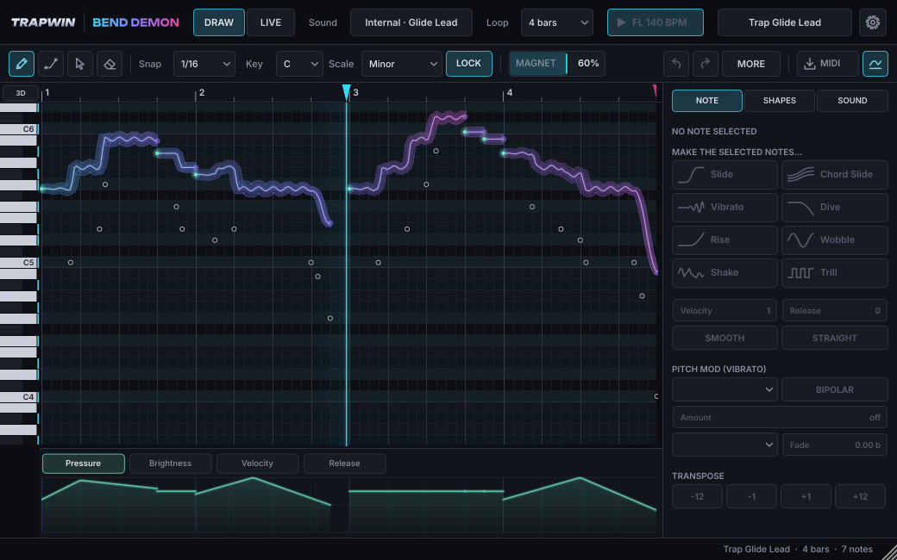
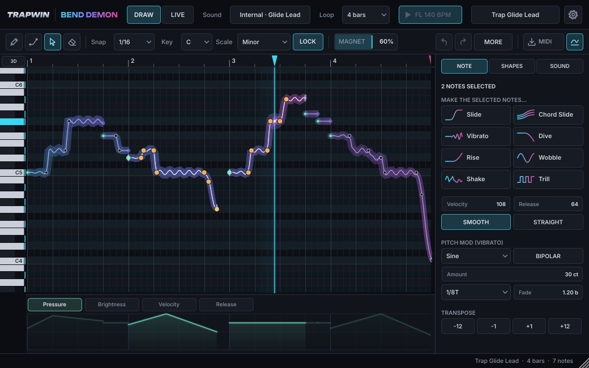
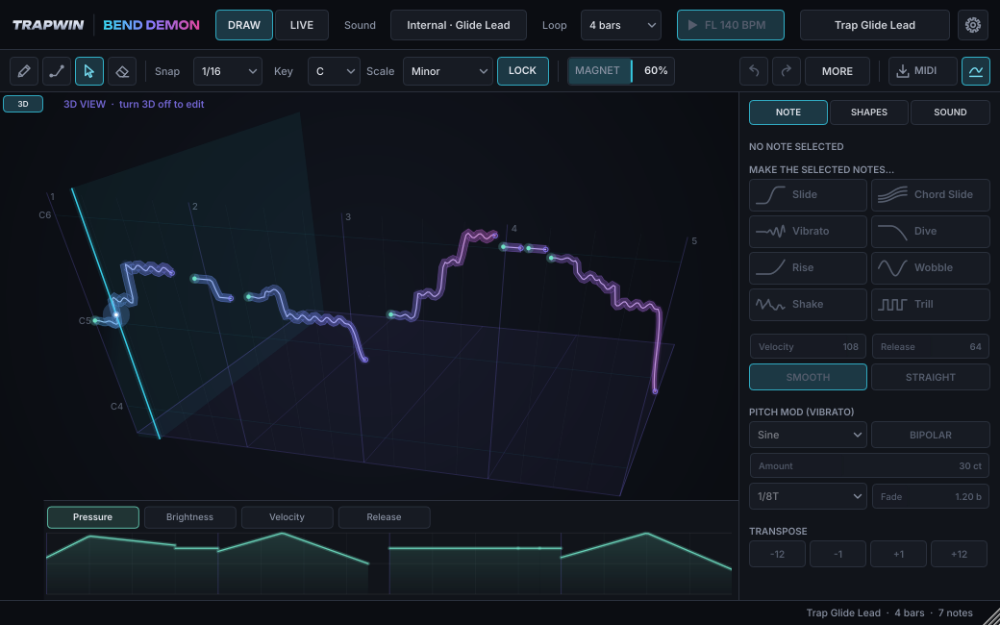

# TrapWin BEND DEMON 2.0

**Draw a line. It slides.**

BEND DEMON is an instrument plugin (VST3 / AU / Standalone) with a **line sequencer**: every line
you draw is one note whose pitch can slide anywhere (MPE: own channel, own 14-bit pitch bend,
pressure and CC74 per note). It plays in sync with the host, with **six built-in sounds** or with a
synth it **hosts inside itself** (Serum 2, Vital, Pigments …, or any non-MPE synth in mono-slide
mode). The 1.x gesture engine is still there: piano-roll notes are turned into slides, dives,
vibrato … live (LIVE mode, or alongside the pattern in DRAW mode), and the same gesture shapes are
one-click actions on drawn notes.

```
pattern (drawn lines) ──► PatternPlayer ──┐
                                          ├─► built-in synth | hosted synth | MIDI out
FL piano roll ──► GestureEngine (live) ───┘
```





*(Screenshots are rendered by the `BendDemonSnapshot` dev tool, headless under Xvfb, from the real
editor and engine. The fonts are the embedded ones.)*

---

## Contents

| Path | What |
|---|---|
| `CMakeLists.txt` | JUCE 8 project. JUCE **8.0.9** is fetched from GitHub with FetchContent (or `-DJUCE_DIR=`). |
| `src/engine/` | Real-time engine, no GUI dependencies: `GestureEngine`, `VoiceAllocator`, `MpeOutput`, `ScaleLock`, `EngineTypes.h`; 2.0: `Pattern` (data model, curves, XML), `PatternPlayer` (sequencer), `PatternExchange` (lock-free hand-off), `PatternTools` (edit commands, gesture baking, capture conversion, MIDI import/export), `PatternFactory` (demo patterns), `CaptureFifo` / `CaptureRecorder`, `InternalSynth` |
| `src/host/HostedPluginManager.*` | Scanning (cached), async loading, atomic hot-swap, hosted editor window, state |
| `src/PluginProcessor.*` | Glue: parameters → gesture engine + sequencer → built-in / hosted synth / MIDI out, state, latency, capture |
| `src/PatternStore.*` | Message-thread owner of the pattern: undo (`juce::UndoManager`), selection, publishing to the audio thread |
| `src/PluginEditor.*`, `src/ui/` | `TopBar`, `EditToolbar`, `VoiceField` (+ `VoiceFieldDraw`: the DRAW canvas), `LineEditor` (tools), `ExpressionLane`, `Inspector`, `StatusBar`, `GesturePad`, `GlowKnob`, `LookAndFeel`, `SynthBrowser`, `Fonts`, `Palette` |
| `src/presets/PresetManager.*` | 9 factory pattern presets + 9 gesture presets + user presets (`.bdpreset` XML incl. the pattern) |
| `src/VisualFifo.h` | Lock-free audio → UI event queue (`juce::AbstractFifo`) + transport anchor |
| `tests/` | Engine unit tests (`juce::UnitTest`): 15 suites, ~35k checks |
| `tools/` | Dev tools (off by default): UI snapshot app (+ UI interaction checks), end-to-end host test, "MPE Probe" test synth |
| `resources/fonts/` | Unbounded (product name) + Inter (UI) (SIL OFL 1.1, licences included), embedded as BinaryData |
| `scripts/` | `build-mac.sh`, `build-win.ps1`, installer files (pkg distribution, Inno Setup `.iss`) |
| `.github/workflows/build.yml` | CI: Linux tests + host test, macOS universal pkg, Windows installer. Signing gated on secrets |
| `MANUAL.md` | User manual (FL Studio workflow) |
| `LICENSE-NOTES.md` | **Read this before selling anything (JUCE licensing).** |

## Plugin metadata

| | |
|---|---|
| Company / Manufacturer | TrapWin, code `Trwn` |
| Product / Plugin code | BEND DEMON, `BdDm` |
| Bundle id | `com.trapwin.benddemon` |
| Version | 2.0.0 |
| Formats | VST3 + Standalone (Windows), VST3 + AU + Standalone (macOS universal arm64/x86_64) |
| Type | Synth/instrument (`IS_SYNTH`), needs MIDI in, produces MIDI out (MIDI-out mode), VST3 category `Instrument\|Synth`, AU `aumu` |

---

## Building

All platforms: CMake ≥ 3.22 and git. The first configure clones JUCE 8.0.9 (≈ 100 MB) into
`build*/_deps`; pass `-DJUCE_DIR=/path/to/JUCE` to use a local checkout instead.

### macOS (universal, signed, notarized, .pkg)

Requires Xcode 15+.

```bash
# one-time: store notarization credentials in the keychain
xcrun notarytool store-credentials "bend-demon-notary" \
    --apple-id you@example.com --team-id ABCDE12345 --password <app-specific-password>

export BD_APP_SIGN_ID="Developer ID Application: Your Name (ABCDE12345)"
export BD_INSTALLER_SIGN_ID="Developer ID Installer: Your Name (ABCDE12345)"
export BD_NOTARY_PROFILE="bend-demon-notary"
./scripts/build-mac.sh
```

The script:
1. configures with the Xcode generator, `CMAKE_OSX_ARCHITECTURES="arm64;x86_64"`, deployment target 10.15
2. builds and runs the engine unit tests
3. builds `BendDemon_VST3`, `BendDemon_AU`, `BendDemon_Standalone` (Release)
4. `codesign --options runtime --timestamp` each bundle (the standalone app gets
   `scripts/installer/mac-entitlements.plist`: library validation disabled so it can load
   third-party plugins)
5. zips the bundles → `notarytool submit --wait` → `stapler staple` each bundle
6. `pkgbuild` three component packages (VST3 → `/Library/Audio/Plug-Ins/VST3`,
   AU → `/Library/Audio/Plug-Ins/Components`, app → `/Applications`) and `productbuild` a
   distribution package with choices, signs it with the installer identity, notarizes and staples it

Output: `dist/mac/BEND-DEMON-2.0.0-mac.pkg`. Leave the variables unset to get an unsigned build.

Manual equivalent:
```bash
cmake -B build-mac -G Xcode -DCMAKE_OSX_ARCHITECTURES="arm64;x86_64"
cmake --build build-mac --config Release --target BendDemon_VST3 BendDemon_AU BendDemon_Standalone
```

Check the AU with `auval -v aumu BdDm Trwn` after installing.

### Windows (MSVC, installer)

Requires Visual Studio 2022 (Desktop C++), Inno Setup 6 for the installer, and the Windows SDK
(`signtool`) for signing.

```powershell
$env:BD_SIGN_CERT_SHA1 = "<thumbprint of your code-signing cert>"   # or BD_SIGN_PFX + BD_SIGN_PFX_PASS
.\scripts\build-win.ps1
```

Builds VST3 + Standalone (x64, static MSVC runtime), runs the tests, signs the `.vst3` and `.exe`
with `signtool /fd sha256 /tr <timestamp>`, then compiles `scripts/installer/BendDemon.iss`, which
installs the VST3 to `C:\Program Files\Common Files\VST3\TrapWin BEND DEMON.vst3` and the standalone app
to `C:\Program Files\TrapWin\BEND DEMON`. Output: `dist\win\TrapWinBendDemon-2.0.0-Windows-Setup.exe`
(signed too, if a certificate is configured).

### Linux (development only)

Linux is not a shipping target, but the engine, plugin and dev tools build there (that is how
this project was verified):

```bash
sudo apt-get install ninja-build libasound2-dev libx11-dev libxext-dev libxrandr-dev libxinerama-dev \
     libxcursor-dev libxcomposite-dev libfreetype-dev libfontconfig1-dev libgl1-mesa-dev xvfb
cmake -B build -G Ninja -DCMAKE_BUILD_TYPE=Release -DBEND_DEMON_BUILD_DEV_TOOLS=ON
cmake --build build --target BendDemonTests && ./build/BendDemonTests_artefacts/Release/BendDemonTests
cmake --build build --target BendDemon_VST3 BendDemon_Standalone BendDemonHostTest MpeProbe_VST3 BendDemonSnapshot
xvfb-run -a ./build/BendDemonHostTest_artefacts/Release/BendDemonHostTest "$PWD/build/MpeProbe_artefacts/Release/VST3/MPE Probe.vst3"
xvfb-run -a -s "-screen 0 1600x1000x24" ./build/BendDemonSnapshot_artefacts/Release/BendDemonSnapshot "$PWD/snapshots"
```

On a machine **without** ALSA / Xrandr / Xinerama / Xcursor / curl dev packages add
`-DBEND_DEMON_LINUX_MINIMAL=ON`. That disables those optional JUCE features, also for JUCE's
`juceaide` helper.

### CMake options

| Option | Default | |
|---|---|---|
| `BEND_DEMON_JUCE_TAG` | `8.0.9` | JUCE git tag for FetchContent |
| `JUCE_DIR` | – | Use a local JUCE checkout |
| `BEND_DEMON_BUILD_TESTS` | ON | `BendDemonTests` console app (+ `ctest`) |
| `BEND_DEMON_BUILD_PLUGIN` | ON | Plugin targets |
| `BEND_DEMON_USE_OPENGL` | ON on macOS, OFF elsewhere | Attach a `juce::OpenGLContext` to the editor |
| `BEND_DEMON_BUILD_DEV_TOOLS` | OFF | Snapshot app, host test, MPE Probe VST3 |
| `BEND_DEMON_LINUX_MINIMAL` | OFF | Linux container builds without optional system deps |

### Continuous integration

`.github/workflows/build.yml` runs on push/PR:

* **linux-tests**: unit tests, plugin compile, end-to-end host test, UI snapshots (uploaded as an artefact)
* **macos**: `scripts/build-mac.sh` on `macos-14`. If `MACOS_CERT_P12_BASE64` is set, it imports the
  Developer ID certs into a temporary keychain, stores notarytool credentials from `APPLE_ID`,
  `APPLE_TEAM_ID`, `APPLE_APP_PASSWORD`, and signs with `MACOS_APP_SIGN_ID` / `MACOS_INSTALLER_SIGN_ID`.
* **windows**: `scripts/build-win.ps1` on `windows-2022` with Inno Setup from Chocolatey. If
  `WIN_CERT_PFX_BASE64` + `WIN_CERT_PASSWORD` are set, it signs.

Without the secrets, unsigned artefacts are still uploaded.

---

## 2.0: the line sequencer (design notes)

* **Model** (`Pattern.h`). A pattern is 1–64 bars. A line = start, length, pitch points (beats,
  MIDI pitch with free fractional part) interpolated with a **monotone cubic** (Steffen: passes
  through every point, never overshoots, a hold stays a hold) or **straight segments**; pressure and
  CC74 curves; velocity and release velocity; a per-line pitch LFO (sine / triangle / square / saws,
  bipolar or unipolar, tempo-relative rate, fade-in). Stored as XML in the project and in presets
  (exact float round trip, unit tested).
* **Playback** (`PatternPlayer`). Each block is cut at 32-sample control ticks. Note starts and ends
  are placed sample-accurately, across loop boundaries (end of the old pass before the start of the
  new one). Each sounding line gets its own member channel; note-on = nearest semitone of the
  line's pitch at that moment, then 14-bit bend relative to it, pressure and CC74 at control rate.
  Transport stop → note-offs. A ppq jump (seek, FL pattern loop) → note-offs, then **chase**: lines
  already under the new position start immediately. Small forward jitter (< 1/64 beat) is tolerated.
* **Channel plan.** One MPE lower zone. LIVE: the gesture engine owns every member channel.
  DRAW: the gesture engine keeps channels 2–5 for live piano-roll notes, the sequencer uses the rest
  (2+live … 1+Voices). A release-all of the gesture engine makes the sequencer re-chase.
* **Mono / legacy** (non-MPE synths). Sequencer on channel 1, last-note priority (returns to the
  older line when the newer ends), new note-on before the old note-off (legato), retrigger when the
  curve leaves the bend range; live gesture output is folded onto channel 1 too. Switched on
  automatically when a synth that is not on the known-MPE list is loaded (with a notice).
* **Audio-thread safety.** Every edit creates an immutable snapshot published through
  `PatternExchange` (atomic pointer exchange; the message thread frees only snapshots older than the
  one the audio thread reports in use). The audio thread never locks, allocates or frees.
* **Undo.** `PatternStore` + `juce::UndoManager`: one undo step per command or per mouse gesture
  (drags are previewed live and committed as one step).
* **Capture.** The gesture engine's MPE output (not the sequencer's) is queued with ppq stamps
  (`CaptureFifo`) into a rolling buffer split at clock jumps (`CaptureRecorder`), then converted to
  lines (per-channel bends → pitch curves, simplified). *Record the next pass* starts at the next
  pattern boundary or right after the host loops back.
* **MIDI export** runs the real `PatternPlayer` offline (1 sample = 1 tick at 960 ppq, 96 control
  updates per beat): MPE (zone setup + per-channel notes, bend, pressure, CC74) or mono pitch bend.
  **Import** reads plain, MPE or pitch-bend MIDI back into lines.
* **Built-in synth** (`InternalSynth`). 16 voices, polyBLEP saw/square, sine, 3-voice unison,
  2-op FM, TPT state-variable low-pass, amp + filter ADSR, drive, pitch punch; pressure → level and
  cutoff, CC74 → cutoff; stereo chorus, `juce::Reverb`, tanh soft clip. Pitch follows the channel
  bend through a 1.5 ms smoother. It plays whenever no hosted synth is selected.

## How the engine works (design notes)

* **MPE lower zone.** Master channel 1, member channels 2 … 1+N (N = *Voices*, 1–15). On load,
  when the synth changes, after panic and when voices or bend range change, BEND DEMON sends the
  MPE Configuration Message (RPN 6 = N on channel 1), then RPN 0 = bend range (2/12/24/**48**/96)
  on **every** member channel, RPN 0 = 2 on the master channel, and centred bend, pressure and CC74.
  Only CC6 (data-entry MSB) is sent, not CC38: some receivers treat RPN data as 14-bit and would
  otherwise read 48 as 6144.
* **VST3 caveat (found and fixed during testing).** In VST3, MIDI CCs travel to the hosted plugin
  as *parameter changes*, and the plugin side rebuilds MIDI grouped by CC number. If an RPN's
  CC101/100/6 share one sample offset they arrive out of order and the RPN is lost: the synth then
  gets no MPE zone and stays silent. Every message of a channel's RPN sequence therefore gets its
  own sample offset (the whole configuration spans 13 samples), and notes in that block start
  after it. A unit test and the end-to-end host test cover this.
* **Channel allocation** (`VoiceAllocator`): reuse the free channel that last played the same
  note, otherwise round robin. If all channels are busy, steal the oldest *releasing* voice
  (dive tail, glide window) first, then the oldest held voice.
* **Per-note bends**: 14-bit (`8192 + semis/range * 8191` up, `* 8192` down), recomputed every
  **32 samples** at exact sample offsets, smoothed with a ~4 ms one-pole, sent only when the value
  changes. Pressure (channel pressure) and timbre (CC74) are sent the same way.
* **GLIDE, delayed note-off (the important choice).** A piano roll writes legato as notes that
  *touch* (note-off and next note-on at the same tick). With GLIDE on, a key-up does **not** send
  the note-off straight away: the voice stays alive for *Glide Window* ms (default 60). If a new
  note starts inside that window, or while the old key is still held (overlap), the **same voice**
  bends from its current pitch to the new note over *Glide Time* with the chosen curve, and no new
  note-on is sent. The voice keeps its original note number; everything after that is pitch bend.
  If no new note arrives, the real note-off goes out when the window ends. Trade-offs: release
  tails start up to one glide window late, and a glide only works within the bend range (±48 by
  default). A bigger jump retriggers. A single new note glides only if at most one key is held, so
  chords played under a melody keep their polyphony.
* **CHORD GLIDE.** Notes starting within *Chord Window* ms (default 12) form a chord. To see the
  whole chord before deciding, the engine delays its input by that window and **reports it as
  plugin latency**, which the DAW compensates (FL Studio PDC). Old voices are matched to new notes
  by repeatedly taking the globally nearest (new note, old voice) pair. Matched voices bend, extra
  notes start new voices, and unmatched old voices release normally.
* **DIVE / RISE.** On key-up the voice stays alive for *Dive Time* (ms, or tempo-synced),
  bends by *Dive Amount* semitones with the dive curve (target snapped to the scale when SCALE LOCK
  is on), lands exactly on the target, then sends the real note-off. With GLIDE also on, the dive
  starts after the glide window, so legato lines don't dive between notes. If DIVE and RISE are
  both on, DIVE wins.
* **VIBRATO** (rate Hz or tempo-synced, depth in cents) fades in over 350 ms once the note has been
  held longer than *Delay*. **WOBBLE** is a tempo-synced sine in semitones. **SHAKE** is smoothed
  random jitter. **TRILL** alternates with the next scale degree (a whole tone without scale lock)
  at a synced rate. Vibrato and trill pause during a dive.
* **PRESSURE / TIMBRE** envelopes (Attack / Swell / Decay, time, amount), scaled by velocity
  (*Vel>Press*, *Vel>Timbre*).
* **No stuck notes.** Transport stop, bypass, synth change, MIDI-out toggle, voice/range change,
  incoming CC123/CC120 and the panic button all trigger `releaseAll`: note-off for every sounding
  voice, then all-notes-off, centred bend and pressure 0 on every member channel. A fuzz test drives
  64 random gesture configurations with 400 random notes each and checks every note-on is matched
  by a note-off.
* **Non-note input.** Incoming pitch wheel, CCs (mod wheel, sustain …), channel pressure and program
  changes go out on the master channel (zone-wide in MPE).

### Threading

* Audio thread: `processBlock` reads parameters through cached `std::atomic<float>*`, runs the
  engine and calls the hosted plugin. No locks, no allocation (MIDI buffers are pre-sized in
  `prepareToPlay`).
* Hosted plugin swap: the new instance is created asynchronously on the message thread, prepared,
  given its state, then published with an atomic pointer exchange. The message thread waits until
  the audio thread has left the old slot before deleting it. The audio thread never waits.
* Engine → UI: `VisualFifo` (`juce::AbstractFifo`, 8192 events) plus atomics for the transport
  anchor. The UI drains it at 60 fps. Events are dropped if the UI isn't reading.

### Hosting details

* Formats: VST3 (all platforms) and AudioUnit (macOS) through `AudioPluginFormatManager::addDefaultFormats()`.
* Scanning runs on the message thread one file per timer tick, with a dead-man's-pedal file:
  a plugin that crashes the scan is skipped next time. The list is cached in
  `%APPDATA%\TrapWin\BEND DEMON\PluginList.xml` / `~/Library/Application Support/TrapWin/BEND DEMON/PluginList.xml`.
* Only instruments are listed, and BEND DEMON never lists itself. Known MPE-capable synths are listed first with an MPE badge.
* Main output set to stereo, other buses disabled. A mono synth is copied to both channels.
* The host's `AudioPlayHead` is forwarded (tempo, ppq, bar, play state, loop).
* Latency = chord-glide lookahead + hosted plugin latency, re-reported when it changes.
* State: BEND DEMON's parameters + `PluginDescription` + base64 plugin state of the hosted synth.
  If a saved synth is missing on another machine, its description is kept so re-saving the
  project doesn't lose it, and the top bar shows `MISSING: <name>`.

---

## What was verified, and what was not

Verified in a Linux container (Ubuntu 24.04, GCC 13 + Clang 18, JUCE 8.0.9):

* Engine unit tests: **35,511 checks, 0 failures**. 1.x: channel allocation, 14-bit bend maths,
  MPE configuration and VST3-safe ordering, glide / chord glide, dive timing, scale snapping,
  stuck-note fuzzing, `juce::MPEInstrument` decoding. 2.0: curve interpolation (no overshoot,
  continuity), pattern playback timing, loop boundaries with odd block sizes, seek + chase, stop,
  jitter tolerance, channel allocation and stealing for overlapping lines, live editing while
  playing, a fuzz of random patterns / seeks / stops / edits (no hanging notes), mono / legacy
  mode (last-note priority, legato order, retrigger outside the bend range), capture conversion
  (incl. a 1.x glide), capture recorder (last N bars, armed pass, host loop), MIDI export (MPE and
  mono, written and read back), MIDI import, gesture baking (all 8), edit tools, magnet, exact XML
  state round trip, the lock-free pattern exchange, the built-in synth (all sounds audible, finite,
  soft-clipped, released; pitch follows the MPE bend).
* `BendDemon_VST3` and `BendDemon_Standalone` build (Release, LTO) with **zero warnings in project
  code** under GCC's JUCE-recommended flags; all project sources also compile warning-free under
  Clang 18 with JUCE's Clang flags (`-Wconversion -Wshadow-all -Wshorten-64-to-32 …`, as Apple clang).
* **pluginval** (strictness 5, in-process) on the Linux VST3: **SUCCESS**.
* **End-to-end hosting** (`BendDemonHostTest`): the `MPE Probe` VST3 hosted through the real
  `HostedPluginManager`: live glide 60 → 64 = **261.62 → 329.67 Hz**; a drawn line 60 → 67 played by
  the sequencer on the preview clock = **261.60 → 392.06 Hz**; project state restore brings back
  the hosted plugin and the pattern.
* **UI**: `BendDemonSnapshot` renders the editor at 1040×650, 800×500 and 640×400 (DRAW, selection +
  lane, SHAPES, SOUND, DIMENSION, LIVE, the no-MPE notice) and drives the canvas with synthetic mouse
  and key events: pencil drag / click, line tool, select-drag (grid + semitones), box select,
  Ctrl+D, undo / redo, eraser, and that the **space bar is not consumed**. All checks pass.
* The Standalone app starts and runs under Xvfb without crashing.

**Not verified here (needs the owner's machines):**

* macOS and Windows builds (MSVC, Apple clang), the AU format, `auval`, signing, notarization and
  installers. The scripts follow Apple's and Microsoft's documented flows but have not been run.
* Real FL Studio behaviour (transport, PDC, MIDI out ports, dropping the exported MIDI file) and
  hosting real commercial synths (Serum 2, Vital, Pigments …).
* Audio quality / CPU of the built-in synth on real hardware (it was only checked numerically).
* OpenGL rendering on macOS (the Linux check used the software renderer).

## Known limitations / risks

* **Real-synth MPE behaviour varies.** Each synth handles MPE its own way. Serum 2, Vital,
  Pigments and Phase Plant must have **MPE enabled in the synth** and should be set to the same
  bend range (±48 by default). Serum 1 and other non-MPE synths treat all 16 channels as one, so
  bends apply to the whole chord.
* **Glide window delays release tails** by up to 60 ms (adjustable, 0 disables it).
* **Chord glide adds latency** (default 12 ms) while enabled. DAWs compensate it, but live playing
  feels it.
* **Plugin scanning is in-process.** A plugin that crashes during scanning takes the host down
  once (it is then skipped). An out-of-process scanner would be the next step.
* **Hosted plugins that require asynchronous instantiation** (some AUv3) are not included in
  the scan.
* **MIDI drag-out** writes a single-track MPE file. FL Studio's piano roll shows the per-channel
  notes, but whether a dropped MPE clip keeps its per-note bends depends on how the target channel
  is set up (an MPE synth on that channel); the mono variant always works with plain synths.
* **Known-MPE list.** MPE support can't be queried reliably from VST3/AU, so a name list decides
  (`HostedPluginManager::isKnownMpeSynth`). A synth not on it gets mono slides (always works); the
  user can switch mono off in the settings menu.
* **Bypass in FL Studio**: FL may stop calling the plugin instead of calling
  `processBlockBypassed`. In that case notes are released on the next transport stop or panic.
* **FL Studio MIDI out**: in MIDI-out mode, FL routes plugin MIDI output through the *MIDI out*
  port settings (see MANUAL). Some FL versions merge channels; test with your target synth.
* **Project load is asynchronous.** When a project opens, the hosted synth is re-created
  asynchronously on the message thread. Any audio the host requests before that finishes is
  silent. This can matter for an immediate offline render straight after loading a project in
  some hosts. It is not an issue in normal use.
* Linux is not a shipping target.

## Licensing

See **[LICENSE-NOTES.md](LICENSE-NOTES.md)**. In short: **JUCE is dual-licensed (AGPLv3 or
commercial). To sell BEND DEMON closed-source you need a JUCE licence** (Indie/Pro) for TrapWin.
The VST3 SDK bundled with JUCE 8.0.9 is under a BSD-style licence: reproduce its notice in
your documentation. The fonts are OFL 1.1.
